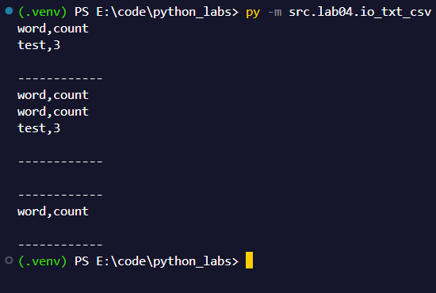
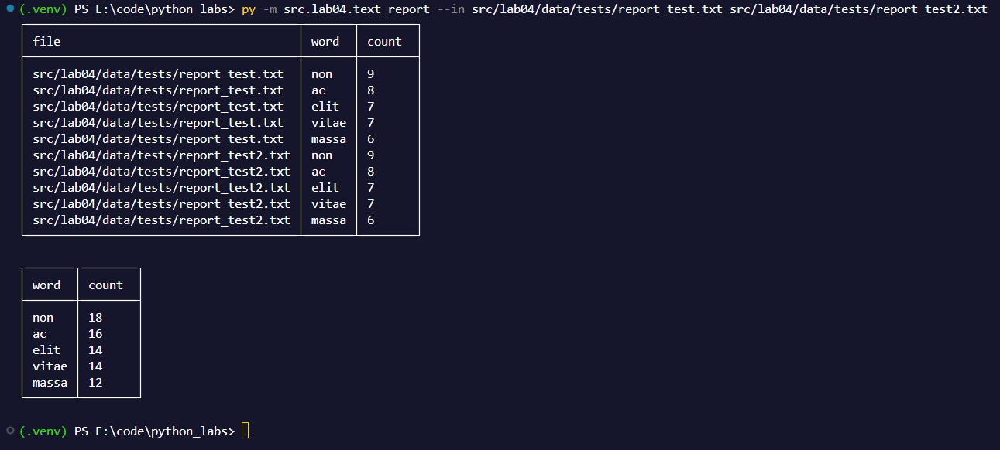

# ЛР04

# FastTravel
[Предисловие](#предисловие)
- [top_n](#1-top_n)
- [tables.py](#2-добавлен-модуль-tables-в-lib)

[Задание А](#задание-а)
- [read_text](#1-read_text)
- [write_csv](#2-write_csv)

[Задание B](#задание-b)
[P.S.](#ps)

# Предисловие

Важно прочитать перед проверкой.

## 1. top_n
Я изменил эту функцию под реалии 4 лабораторной работы. Теперь если передать в качестве аргумента n значение -1, то результат не будет обрезаться, а возвращаться полностью.

## 2. Добавлен модуль tables в /lib/
Внутри него две функции.

check_rows - отвечает за проверку соответствия длины списка рядов (и заголовков, если они переданы)
create_table - функция, которая может создать красивую таблицу. Алгоритм работает на подобие генератора таблиц из 3 лабы, но усовершенствован для работы с любыми таблицами. Ну и выглядит классно.


# Задание А


## 1. read_text
```py
def read_text(path: str | Path, encoding:str = "utf-8") -> str:
    """
    Проверяет существование файла, является ли путь файлом и возвращает его содержимое декдированное в строку.
    
    read_text(path: str | Path, encoding:str = "utf-8") -> str
        path: путь к файлу (строка или объект Path)
        encoding: кодировка файла (по умолчанию "utf-8")
        
    Ошибки:
        FileNotFoundError: если файл не найден
        ValueError: если путь не является файлом
        
    42 бро
    """
    p = Path(path)
    
    # Checkers
    if not p.exists():
        raise FileNotFoundError(f"File not found: {p}")
    if not p.is_file():
        raise ValueError(f"Path is not a file: {p}")
    
    return p.read_text(encoding=encoding)
```

Примеры запуска (тесты можно посмотреть в конце файлика с кодом [ТЫК](../../src/lab04/io_txt_csv.py)):
Тесты объденины с тестами write_csv.




## 2. write_csv
```py
def write_csv(rows: list[tuple | list], path: str | Path, header: tuple[str, ...] | None = None) -> None:
    """
    Функция записывает .cvs файлики. От себя добавил создание папок, которых нет по пути.
    Сначало проверяет целостность данных, которые пришли нам на вход. Затем проверяет существует файл и 
    является ли он файлом в принципе (чтобы не перезаписывать папку, что буквально невозможно).
    
    Потом просто создает недостающие папки на пути.
    
    Запись происходит в кодировке utf-8. Если есть заголовки, то сначало запишет их. Потом построчно соеденит все значения в каждом ряду через запятую.
    Ну и все впринципе.
    
    write_csv(rows: list[tuple | list], path: str | Path, header: tuple[str, ...] | None = None) -> None
        rows: список строк (каждая строка - кортеж или список)
        path: путь к файлу (строка или объект Path)
        header: заголовок (кортеж строк) или None
    
    Ошибки:
        ValueError: если строки не соответствуют заголовку или содержат пустые строки
        ValueError: если путь не является файлом    
    """    
    p = Path(path)
    
    # Checkers
    if p.exists() and not p.is_file():
        raise ValueError(f"Path is not a file: {p}")
    if header is not None:
        check_rows(rows, header)
    else:
        check_rows(rows)
        
    # Creating dirs 42
    if not p.parent.exists():
        p.parent.mkdir(parents=True, exist_ok=True)
        
    # Write
    with p.open("w", encoding="utf-8") as f:
        if header is not None:
            f.write(",".join(header) + "\n")
        for row in rows:
            f.write(",".join(str(cell) for cell in row) + "\n")
```

Примеры запуска (тесты можно посмотреть в конце файлика с кодом [ТЫК](../../src/lab04/io_txt_csv.py)):
Тесты объденины с тестами write_csv.


# Задание B
Код отдельно, потому что большой. Посмотреть можно тут: [ТЫК](../../src/lab04/text_report.py)

Все изменения, которые я описал в предисловии, были сделаны в основном для этого задания.

Начнем с того, что я использовал встроенную в питон библиотеку argparse, с которой ранее не работал, но было интересно покопаться в документации. Парсим аргументы. Если посмотрите код, то заметите там старую функцию для парсинга аргументов. Просто изначально использование argparse не задумывалось, но получилось как получилось. А удалять я не хочу, пусть останется в знак того, что я изучал проблему.

Продолжая повествование, я решил добавить в код *многопроцессность*. То есть, обработка данных для отчета по отдельности и для отчета по всему работает парралельно. Почему я использовал мультипроцессинг, а не threading? На это есть причина: из-за GIL, потоки threading не могут выполняться на разных ядрах. Они выполняются одновременно, просто каждый по чуть-чуть. А мультипроцессинг же создает изолированные процессы в самой системе, из-за чего программа использует больше ресурсов, а следовательно выполняется быстрее.

Дальше, для каждоый задачи своя функция. Работают они схожим образом, используя обновления функции top_n. По факту обьяснять там почти нечего, так как это буквально ЛР03, но чуть чуть под другим углом, кроме обработки ошибок. Для обработки ошибок есть отдельный кусок кода в конце файла. Он отвечает за то, чтобы правильно вывести ошибку и указать в каком конкретно процессе случился сбой. Больше про него сказать нечего.

Затем, прямо внутри процессов собираюстя таблички. Я постарался сделать эти таблички максимально красивыми и я считаю, что у меня получилось. Также, при помощи ранее созданного в задании А, данные упаковываются в .csv.

Отдельно хочу упомянуть, что программа умеет рабоать с несколькими файлами на входе.

--in можно передать от 1 до n файлов. Обязательный аргумент

--per-file файл вывода результата для пофайловой обработки, по дефолту src/lab04/data/reports/report_per_file.csv

--total файл для вывода общей статистики, по дефолту src/lab04/data/reports/report_total.csv

--encoding можно установить кодировку входных файлов (одну на всех). По дефолту utf-8. Поддержка нескольких кодировок не предусмотрена.


Программа не упадет, если ввести пустые файлы. Об этом можно не беспокоиться. К сожалению в тесты это не влезает, но работает.

Примеры запуска (обрезан топ до 5 слов, чтобы влезло):




Отдельно файлы .csv:
1. [report_per_file.csv](../../src/lab04/data/reports/report_per_file.csv)
2. [report_total.csv](../../src/lab04/data/reports/report_total.csv)


# P.S.
Очень крутая лабораторная работа. Никогда не работал с аргументами всерьез, да и таблички получились реально классными. Велосипед, зато какой! Мне понравилось, спасибо!