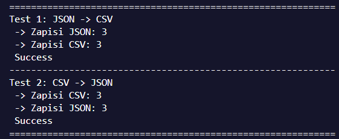
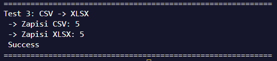

# ЛР05

# FastTravel
1. [Задание А](#задание-a)
- 1. [json -> csv](#json_csv)
- 2. [csv -> json](#csv_json)
- 3. [Тесты](#тесты-задания-а)

2. [Задание В](#задание-b)
- [Тесты](#тесты-задания-в) 


# Задание A
## json_csv
```py
def json_to_csv(json_path: str, csv_path: str) -> None:
    """
    Конвертер json в csv.
    
    Открывает файл с json, читает его. Затем идут проверки (блок Checkers). Там мы проверяем данные на валидность.
    Затем через стандартный DictWriter в библиотеке csv записываю снова в файл.
    
    Отдельно ищу все поля, которые могу встретиться. Если в json отсутвует то или иное поле, то врайтер не упадет. 
    
    Отдельно есть блок для обработки ошибок. Он ловит ошибку файл не найден и ошибку чтения json отдельно и выводит кастомные ValueError.
    Все остальные ошибки идут через последний блок, который просто рейзит ошибку
    """
    
    try:
        # Reader
        with open(json_path, "r", encoding="utf-8") as f:
            data = json.load(f)

        # Checkers
        if not isinstance(data, list):
            raise TypeError("JSON file must have a list object")
        if not all([isinstance(i, dict) for i in data]):
            raise ValueError("There is no dicts in list")
        if len(data) == 0:
            raise ValueError("JSON must have 1 object at least")
        # check_headers(data) - dedicated

        # Writer
        all_keys = set()
        for row in data:
            all_keys.update(row.keys())
        
        headers = sorted(list(all_keys))      
        with open(csv_path, "w", newline="", encoding="utf-8") as f:
            writer = csv.DictWriter(f, fieldnames=headers, extrasaction="ignore")
            writer.writeheader()
            writer.writerows(data)

    # Errors proceeder
    except FileNotFoundError as e:
        raise FileNotFoundError("Cant find file to read.")
    except JSONDecodeError as e:
        raise ValueError("Cant decode .json file")
    except Exception as e:
        raise e
```

## csv_json
```py
def csv_to_json(csv_path: str, json_path: str) -> None:
    """
    Открываем файл, определяем диалект по семплу из 2048 символов, проверем есть ли хеддер.
    Читаем данные через диктридер, передав в него определенный диалект.
    Отдельно проверяем, что данные (кол-во столбцов и их имена) совпадают.
    Записываем через json.dump
    
    Обработчик ошибок отлавливает только отсутствующий файл, а все остальные ошибки кидает напрямую.
    """
    
    try:
        # Reader
        with open(csv_path, "r", encoding="utf-8") as f:
            sample = f.read(2048)
            f.seek(0)
            
            sniffer = csv.Sniffer()
            dialect = sniffer.sniff(sample)

            # Header Checker
            if not sniffer.has_header(sample):
                raise ValueError(".csv must have headers")
            
            # Data Loader
            data = list(csv.DictReader(f, dialect=dialect))
            
        # Data and structure checkers
        if len(data) == 0:
            raise ValueError(".csv must have a least 1 data row")
        check_headers(data)

        # Writers
        with open(json_path, "w", encoding="utf-8") as f:
            json.dump(data, f, indent=2, ensure_ascii=False)

    # Errors proceeder
    except FileNotFoundError as e:
        raise FileNotFoundError("Cant find file to read.")
    except Exception as e:
        raise e
```


## Тесты задания А
Тесты (файлики [ТЫК](../../data/)):




# Задание B

```py
def csv_to_xlsx(csv_path: str, xlsx_path: str) -> None:
    """
    Функция конвертирует .csv в .xlsx
    Используется дополнительная библиотека openpyxl.
    В проверках сделано так, что программа требует наличие хеддера и как минмум 1 ряда с данными.
    
    Открываем csv, читаем семпл, полуаем тип разделителей (диалект), читаем уже полный файл, записываем в xlsx через библиотеку openpyxl.
    И меняем размеры колонок (берем максимальную длину значения в колонке + 3)
    """
    
    try:
        # xlsx converter setup
        wb = openpyxl.Workbook()
        ws = wb.active
        ws.title = "Sheet1"  # type: ignore

        # Reader
        with open(csv_path, "r", encoding="utf-8") as f:
            sample = f.read(2048)
            dialect = csv.Sniffer().sniff(sample)
            f.seek(0)
            
            reader = csv.reader(f, dialect=dialect)
            rows = list(reader)

        #Checkers
        if len(rows) <= 1:
            raise ValueError("Not enough values in .csv. File must have at least 2 rows (Header + 1 data row)")
        check_rows(rows)  # type: ignore

        # Writer
        for row in rows:
            ws.append(row)  # type: ignore
            
        for col in ws.columns:  # type: ignore
          max_len = max(len(str(cell.value or "")) for cell in col)
          col_letter = openpyxl.utils.get_column_letter(col[0].column)  # type: ignore
          ws.column_dimensions[col_letter].width = max(max_len + 3, 8)  # type: ignore
        
        wb.save(xlsx_path)

    # Errors proceeder
    except FileNotFoundError as e:
        raise FileNotFoundError("Cant find file to read.")
    except Exception as e:
        raise e
```

## Тесты задания В
Тесты (файлики [ТЫК](../../data/)):

