# Lab06

# FastTravel
1. [Важные обновления](#важные-обновления)
2. [cli_text](#cli_text)
    1. [cat_command](#cat_command)
        1. [Стандартный запуск](#стандартный-запуск)
        2. [С -n](#с--n)
        3. [--help](#--help)
        4. [param error](#param-error)
    2. [stats](#stats)
        1. [Стандартный запуск](#стандартный-запуск-1)
        2. [С --top](#с---top)
        3. [--help](#--help-1)
        4. [param error](#param-error-1)
3. [cli_convert](#cli_convert)
    1. [json2csv](#json2csv)
    2. [csv2json](#csv2json)
    3. [csv2xlsx](#csv2xlsx)
    4. [--help](#--help-2)
    5. [param error](#param-error-2)
4. [data/out](#dataout)


# Важные обновления
Добавил io_util.py в /lib/. 
Перенес туда обычную читалку текста. а также написал функцию для построчного чтения текста.

```py
def read_text_by_lines(path: str | Path, encoding: str = "utf-8"):
    """
    Функция читает файл построчно.
    
    read_text_by_lines(path: str | Path, encoding:str = "utf-8") -> str
        path: путь к файлу (строка или объект Path)
        encoding: кодировка файла (по умолчанию "utf-8")
        
    Ошибки:
        FileNotFoundError: если файл не найден
        ValueError: если путь не является файлом
    """
    path = Path(path)
    
    # Checkers
    if not path.exists():
        raise FileNotFoundError(f"Файл не найден: {path}")
    if not path.is_file():
        raise ValueError(f"Указанный путь не является файлом: {path}")
    
    with open(path, "r", encoding=encoding) as f:
        for line_number, line in enumerate(f, start=0):
            yield (line_number, line.strip())
```

Ну и там еще по мелочи.


# cli_text
Сделано весьма простенько.
Код тут: [ТЫК](../../src/lab06/cli_text.py)

Красткое обьяснение:
Настраиваем аргпарсе, добавляем команды. Затем просто передаем все нужные аргументы, в зависимости от команды, в функции, отвечающие за соответствующие действия.

## cat_command
По дефолту моя функция для построчного чтения возвращает кортеж из номера строки (с нуля) и самой строки.

Поэтому, все, что нужно сделать, это просто пробежаться циклом и просто вывести каждую строку. Для номеров строк я также сделал изменение цвета. Чтобы просто выглядело интереснее.

ВАЖНО! Я реализовал функцию проверки на перенос строки. Как оно работает: сохраняется токен предыдущей строки в buffer, затем мы считаем статистику по новому куску: буфер + линия - последний токен линии. Последний токен линии записывается в буффер, а последний символ (не пробел) записывается в final_char. Если при следующей итерации final_char == "-", то я приклеиваю последний токен к новой строке без дефиса.

ЕЩЕ ОДНО ВАЖНОЕ УТОЧНЕНИЕ! Если это не перенос, а составное слово (кто-нибудь, что-то итд), то оно засчитается как ктонибудь и ктото. К сожалению у меня нет столько времени, чтобы писать на чистом питоне настолько точный парсер. В общем и целом, все, что я хотел реализовать, работает и в рамках лабораторной работы и ее требований - запустится на ура. 

В конце не забываю обработать оставшийся буффер, чтобы ничего не потерялось

### Стандартный запуск
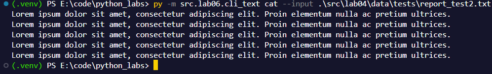

### С -n
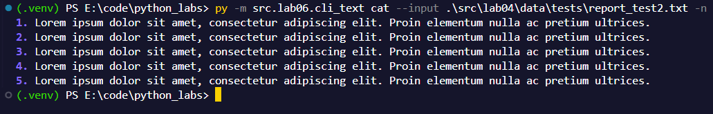

### --help
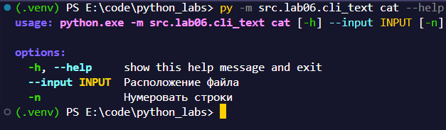

### param error
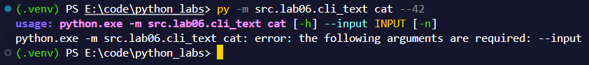

## stats
Бежим по файлу, тоже построчно.
Считаем частоту слов в строке, записываем в общий словарик stats. Выводим красивую табличу.

### Стандартный запуск
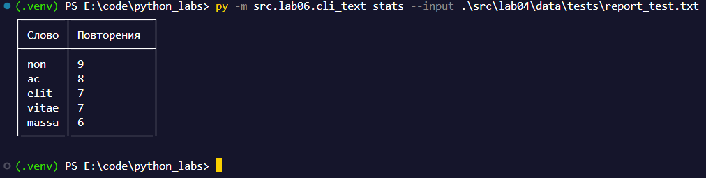

### С --top
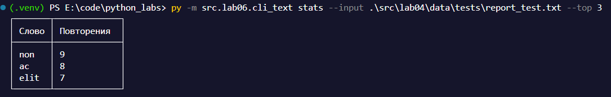

### --help
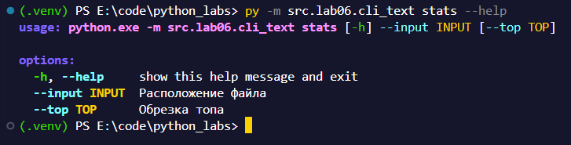

### param error
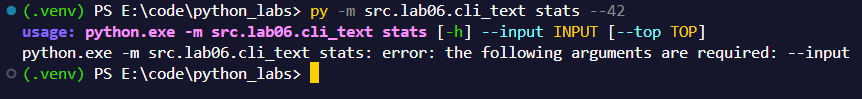


Все остальные ошибки точно также как и в прошлых лабах.

# cli_convert
Читаем аргументы, в зависимости от команды закидываем в соответствующую функцию из лаб05.
Код тут: [ТЫК](../../src/lab06/cli_convert.py)

## json2csv
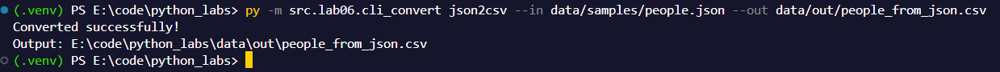

## csv2json
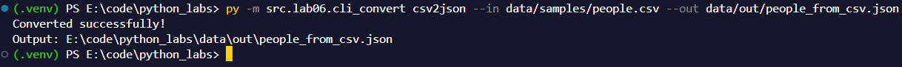

## csv2xlsx
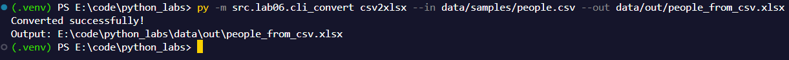

## --help
На все подкоманды одновременно
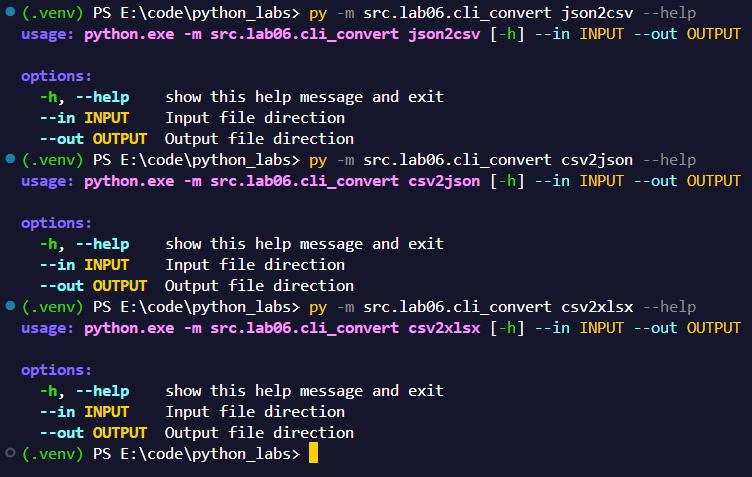

## param error
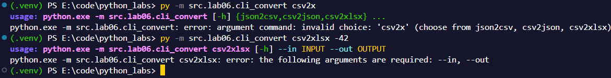


# data/out
Результаты выполнения конвертера лежат в папке data/out. Это ровно те же файлы с лабы номер 5, потому что разницы толком нет, кроме как в форме запуска.
