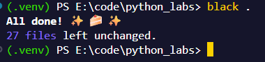
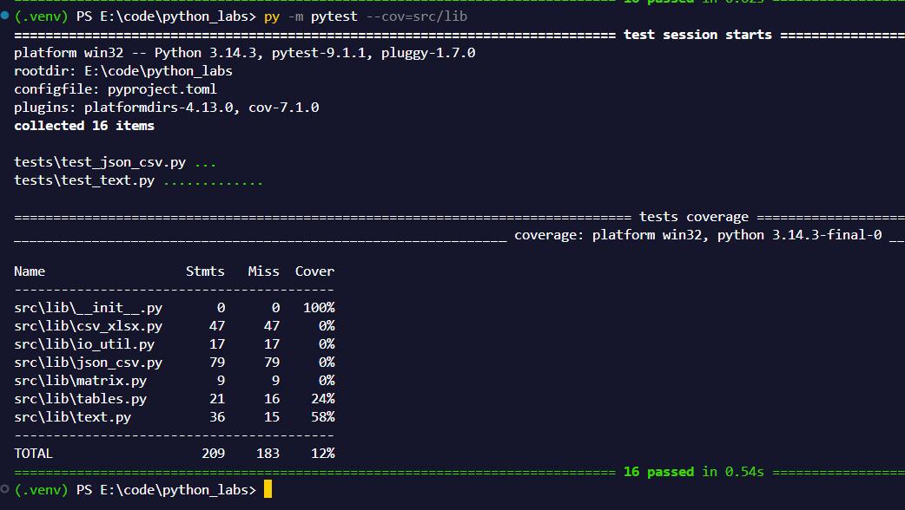

# Лаб07

# FastTravel
1. [test_text](#test_text)
    - [normalize](#normalize)
    - [tokenize](#tokenize)
    - [count_freq](#count_freq)
    - [top_n](#top_n)
2. [test_json_csv (а также csv_xlsx)](#test_json_csv-csv_xlsx-тоже-тут)

# По теории
Добавил pyproject.toml, заполнил его по примеру.

При помощи black исправил структуру.



# test_text

## normalize
Через параметрайз закидываю данные для тестирования (скопированные из тест кейсов лабы 3).

```py
@pytest.mark.parametrize(
    "text, casefold, yo2e, expected",
    [
        ("ПрИвЕт\nМИр\t", False, True, "привет мир"),
        ("ёжик, Ёлка", True, True, "ежик, елка"),
        ("Hello\r\nWorld", False, False, "hello world"),
        ("  двойные   пробелы  ", True, False, "двойные пробелы"),
    ],
)
def test_normalize(text, casefold, yo2e, expected):
    assert normalize(text, casefold=casefold, yo2e=yo2e) == expected
```

## tokenize
Тоже самое, что и с normalize

```py
@pytest.mark.parametrize(
    "text, expected",
    [
        ("привет мир", ["привет", "мир"]),
        ("hello,world!!!", ["hello", "world"]),
        ("по-настоящему круто", ["по-настоящему", "круто"]),
        ("2025 год", ["2025", "год"]),
        ("emoji 😀 не слово", ["emoji", "не", "слово"]),
    ],
)
def test_tokenize(text, expected):
    assert tokenize(text=text) == expected
```

## count_freq
Same

```py
@pytest.mark.parametrize(
    "tokens, expected",
    [
        (["a", "b", "a", "c", "b", "a"], {"a": 3, "b": 2, "c": 1}),
        (["bb", "aa", "bb", "aa", "cc"], {"aa": 2, "bb": 2, "cc": 1}),
    ],
)
def test_count_freq(tokens, expected):
    assert count_freq(tokens) == expected
```

## top_n
тайлера здесь нет...

```py
@pytest.mark.parametrize(
    "freq, expected",
    [
        ({"a": 3, "b": 2, "c": 1}, [("a", 3), ("b", 2)]),
        ({"aa": 2, "bb": 2, "cc": 1}, [("aa", 2), ("bb", 2)]),
    ],
)
def test_top_n(freq, expected):
    assert top_n(freq, n=2) == expected
```


# test_json_csv (csv_xlsx тоже тут)

Они все скопированы из лаб05. Изменения: добавил (зачем то) pytest.fixture для путей.

[Code](../../tests/test_json_csv.py)

# Результат выполнения тестов.



# P.S.
Ну у меня правда не хватает фантазии написать описания по больше, а нейронкой писать ну как будто шляпа...
